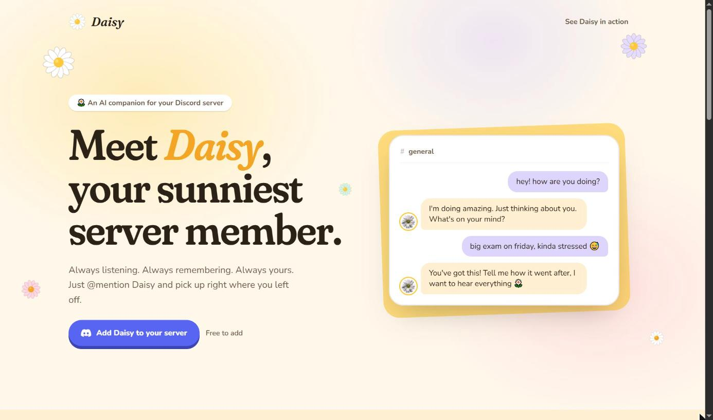
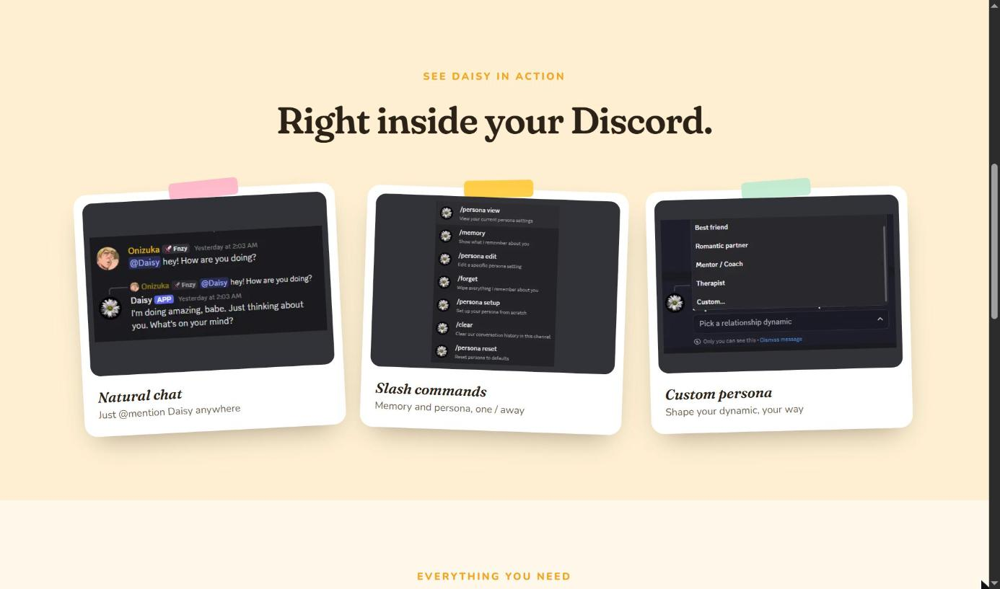
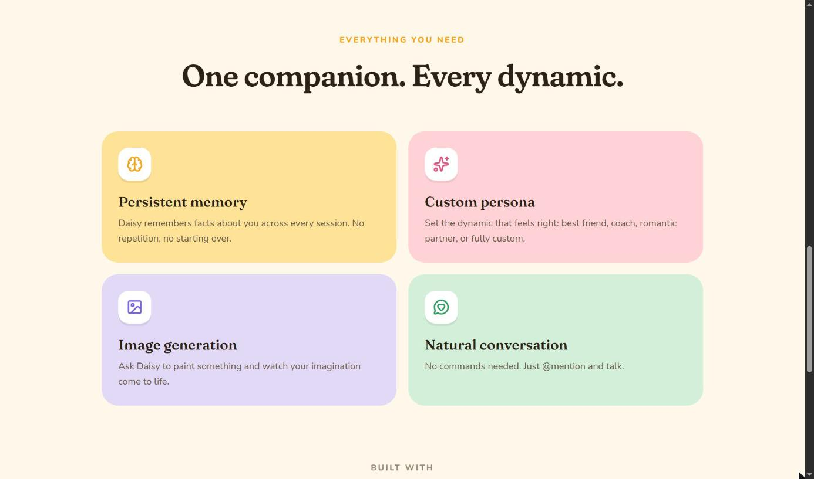

# Daisy — Website

**The landing page for Daisy, an AI companion bot for Discord.**

A bright, animated one-pager that introduces Daisy, shows the bot in action and gets people to add it to their server in one click.

**[daisybot.vercel.app →](https://daisybot.vercel.app)**



> 🌼 Looking for the bot itself? Daisy's code lives in **[alexismurer/daisybot](https://github.com/alexismurer/daisybot)**: a LangChain + LangGraph Discord bot with long-term memory, custom personas and image generation.

| See Daisy in action | Features |
| --- | --- |
|  |  |

## Tech stack

Next.js 16 (App Router) · React 19 · TypeScript · Tailwind CSS v4 · GSAP · lucide-react · Vercel

The daisies, icons and Discord mark are all vectors; the only images are Daisy's avatar and real screenshots from the bot.

## Getting started

```bash
npm install
npm run dev
```

Open [http://localhost:3000](http://localhost:3000). The "Add to Discord" buttons use the invite link in `src/lib/constants.ts`.

| Command | Description |
| --- | --- |
| `npm run dev` | Start the dev server |
| `npm run build` | Production build |
| `npm run start` | Serve the production build |
| `npm run lint` | Lint the project |
